# Emotion Detection in Conversational Text — DistilBERT vs XLNet vs RoBERTa vs BigBird

Official code, trained models, and results for the paper:

> **Comparative Analysis of DistilBERT, XLNet, RoBERTa & BigBird for Emotion Detection in Conversational Text**
> Arslan Ahmed, Barkha, Tushar Kanjwani, Shahzad Nasim
> *ILMA Journal of Technology & Software Management (IJTSM)*, Vol. 6, Issue 1
>
> 📄 **Paper:** https://ijtsm.ilmauniversity.edu.pk/arc/Vol6/i1p1  ·  [PDF in this repo](paper/Comparative_Analysis_DistilBERT_XLNet_RoBERTa_BigBird_Emotion_Detection.pdf)
>
> 🤗 **Models:** [DistilBERT](https://huggingface.co/arslanahmed3/emotion-distilbert) · [XLNet](https://huggingface.co/arslanahmed3/emotion-xlnet) · [RoBERTa](https://huggingface.co/arslanahmed3/emotion-roberta) · [BigBird](https://huggingface.co/arslanahmed3/emotion-bigbird)

We fine-tune four Transformer models on one shared dataset and pipeline to classify text into six emotions: **anger, fear, joy, love, sadness, surprise**. We then compare them on accuracy, precision, recall, F1, and confusion matrices. A small Flask web app lets you try each trained model on your own text.

---

## Results

Test set: 2,000 samples. These figures come from the notebooks in [`notebooks/`](notebooks) and match Table II of the paper.

| Model      | Test Accuracy | Macro F1 | Weighted F1 | Final-epoch val. accuracy | Epochs | Notable strengths      |
|------------|:-------------:|:--------:|:-----------:|:-------------------------:|:------:|------------------------|
| DistilBERT | 92.95 %       | 0.89     | 0.93        | 93.55 %                   | 20     | Joy, sadness; fastest  |
| XLNet      | **93.20 %**   | 0.89     | 0.93        | 93.30 %                   | 20     | Fear (recall 0.96), joy |
| RoBERTa    | 93.15 %       | 0.89     | 0.93        | **94.20 %**               | 20     | Most balanced across classes |
| BigBird    | 93.00 %       | 0.88     | 0.93        | 93.0 %                    | 6      | Sadness; long inputs (512 tokens) |

**Key findings**

- RoBERTa reached the highest validation accuracy and had the most balanced per-class precision and recall.
- XLNet had the best test accuracy and the strongest recall on *fear*.
- DistilBERT comes within 0.25 pp of the best model at a fraction of the cost, so it is the practical pick for real-time use.
- Every model struggles with ***surprise***, the rarest class (3.6 % of training data). It is most often confused with *fear*. *love* is often confused with *joy*.

### Confusion matrices

| DistilBERT | XLNet |
|:---:|:---:|
| 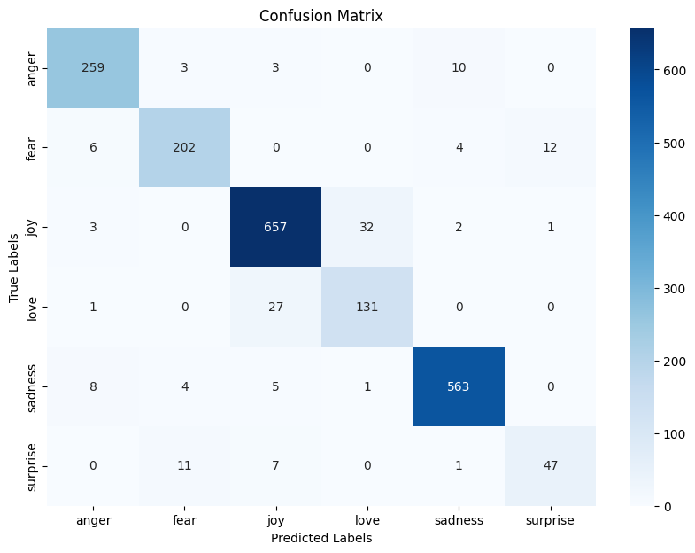 |  |
| **RoBERTa** | **BigBird** |
| 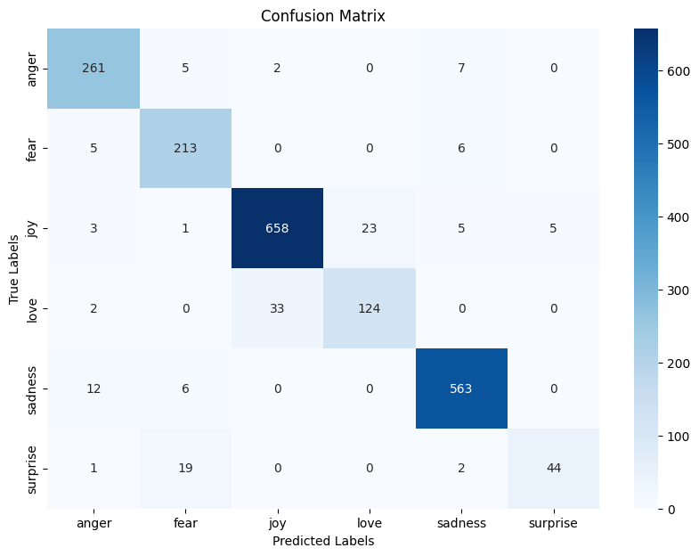 | 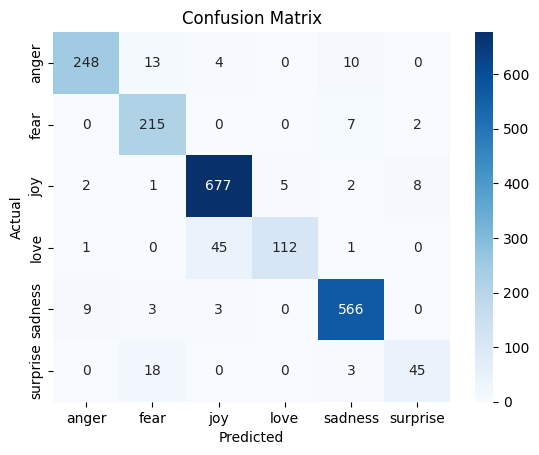 |

### Training curves

| DistilBERT | XLNet |
|:---:|:---:|
| 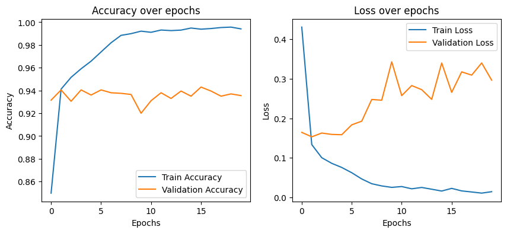 | 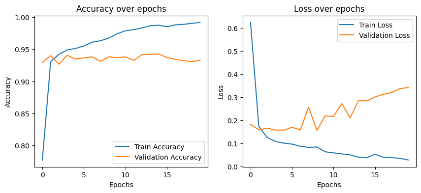 |
| **RoBERTa** | **BigBird** |
| 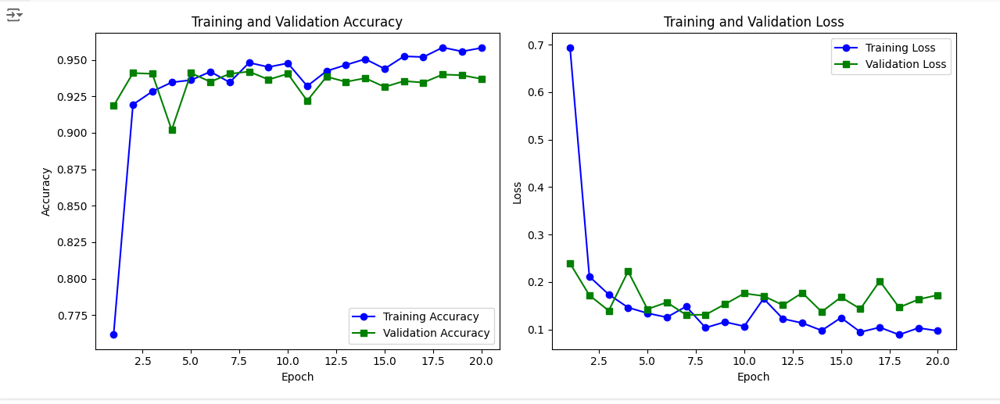 | 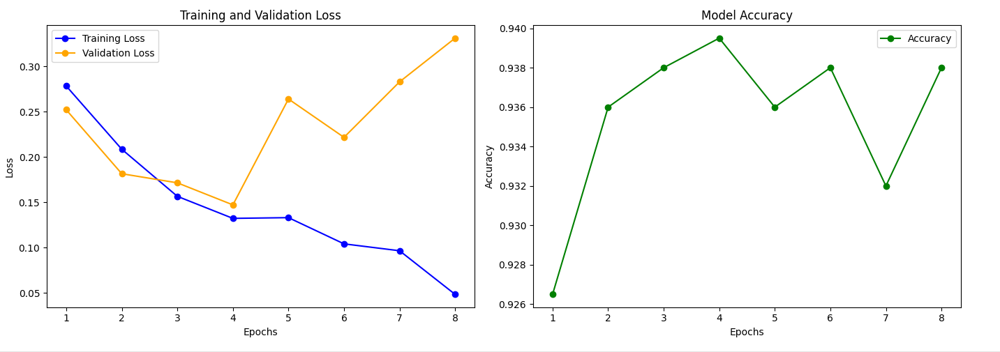 |

---

## Dataset

[Emotions Dataset for NLP](https://www.kaggle.com/datasets/praveengovi/emotions-dataset-for-nlp) on Kaggle. Each line is `text;label`. The data is included in [`data/`](data).

| Split | Samples | joy | sadness | anger | fear | love | surprise |
|-------|--------:|----:|--------:|------:|-----:|-----:|---------:|
| train | 16,000 | 5,362 | 4,666 | 2,159 | 1,937 | 1,304 | 572 |
| val   | 2,000  | 704   | 550   | 275   | 212   | 178   | 81  |
| test  | 2,000  | 695   | 581   | 275   | 224   | 159   | 66  |

Label encoding, used by every model and by the app:

| anger | fear | joy | love | sadness | surprise |
|:-----:|:----:|:---:|:----:|:-------:|:--------:|
| 0 | 1 | 2 | 3 | 4 | 5 |

<p align="center">
  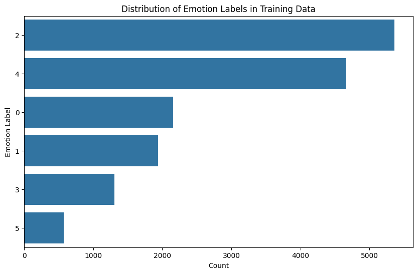
  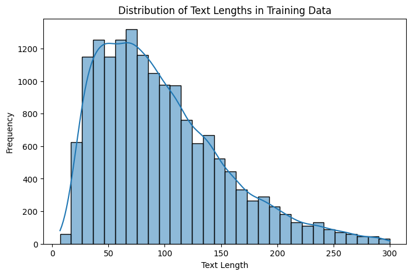
</p>

---

## Methodology

1. **Preprocessing:** lowercasing, punctuation, URL and username removal, stop-word removal, and noise reduction.
2. **Label encoding:** scikit-learn `LabelEncoder`, with the mapping shown above.
3. **Tokenization:** each model's own tokenizer (WordPiece, SentencePiece, or byte-level BPE), with `padding=True, truncation=True`.
4. **Fine-tuning:**

| Model | Base checkpoint | Framework | Optimizer / LR | Batch | Max len | Epochs |
|-------|-----------------|-----------|----------------|------:|--------:|-------:|
| DistilBERT | `distilbert-base-uncased` | TensorFlow / Keras | Adam 5e-5 | 32 | 128 | 20 |
| XLNet      | `xlnet-base-cased`        | TensorFlow / Keras | Adam 5e-5 | 32 | 128 | 20 |
| RoBERTa    | `roberta-base`            | TensorFlow / Keras | Adam 5e-5 | 32 | 128 | 20 |
| BigBird    | `google/bigbird-roberta-base` | PyTorch (HF `Trainer`) | AdamW 2e-5 | 8 | 512 | 6 |

5. **Evaluation:** accuracy, per-class precision, recall and F1 (macro and weighted), and confusion matrices, all with scikit-learn.

All training ran on Google Colab GPUs.

---

## Repository structure

```
├── app.py                     # Flask web demo (all 4 models)
├── test_models.py             # Interactive CLI: compare all models on the same input
├── download_models.py         # Fetch the trained models from the Hugging Face Hub
├── templates/index.html       # Web UI
├── notebooks/
│   ├── 01_DistilBERT.ipynb    # Final training + evaluation (20 epochs)
│   ├── 02_XLNet.ipynb
│   ├── 03_RoBERTa.ipynb
│   ├── 04_BigBird.ipynb       # 6 epochs, PyTorch
│   └── early_experiments/     # Earlier 5-epoch DistilBERT & XLNet runs
├── models/                    # Fine-tuned weights (download from Hugging Face; see models/README.md)
├── data/                      # train / val / test splits
├── results/
│   ├── figures/               # Clean figures used in the paper
│   ├── screenshots/           # Notebook output screenshots (model summaries, epochs, reports)
│   ├── demo/                  # Web app screenshots
│   └── early_experiments/     # Figures from the 5-epoch runs
└── paper/                     # Published paper (PDF)
```

---

## Getting started

### 1. Install

TensorFlow 2.15 needs **Python 3.10 or 3.11**.

```bash
git clone https://github.com/arslanahmedbhutto/Emotion-Detection-Transformers.git
cd Emotion-Detection-Transformers
python -m venv .venv
# Windows: .venv\Scripts\activate     macOS/Linux: source .venv/bin/activate
pip install -r requirements.txt
```

> Transformers 5.x removed TensorFlow model classes. Three of the trained models are TensorFlow checkpoints, so `requirements.txt` pins `transformers` to 4.x.

### 2. Get the trained models

The fine-tuned models are on the **Hugging Face Hub**. Each is 250–500 MB, which is too large for GitHub. Download all four into `models/` with:

```bash
python download_models.py
```

| Model | Hugging Face |
|-------|--------------|
| DistilBERT | [arslanahmed3/emotion-distilbert](https://huggingface.co/arslanahmed3/emotion-distilbert) |
| XLNet      | [arslanahmed3/emotion-xlnet](https://huggingface.co/arslanahmed3/emotion-xlnet) |
| RoBERTa    | [arslanahmed3/emotion-roberta](https://huggingface.co/arslanahmed3/emotion-roberta) |
| BigBird    | [arslanahmed3/emotion-bigbird](https://huggingface.co/arslanahmed3/emotion-bigbird) |

You can also retrain them with the notebooks. See [`models/README.md`](models/README.md).

### 3. Run the web app

```bash
python app.py
```

Open http://127.0.0.1:5000, type a sentence, pick a model, and click **Analyze Emotion**.

<p align="center">
  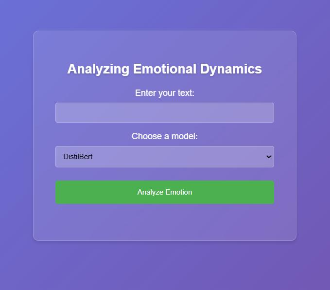
  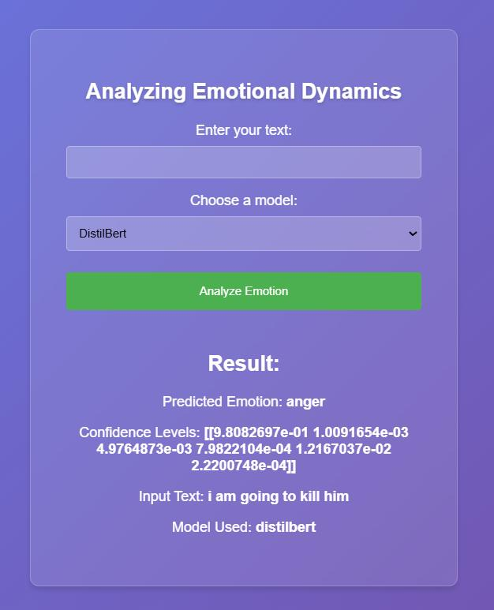
</p>

*Example: DistilBERT classifies "i am going to kill him" as **anger** with 98.1 % confidence. "Confidence Levels" lists the probability of each class in the order anger, fear, joy, love, sadness, surprise.*

### 4. Compare all models from the terminal

```bash
python test_models.py
```

```
Enter emotion text: i feel so lucky to have friends like you
  DistilBERT:  Emotion: JOY ...
  XLNet:       Emotion: JOY ...
  ...
```

### 5. Retrain

Open the notebooks in `notebooks/`. They were written for Google Colab, so change the Google Drive paths to point at `data/` when running locally.

---

## Citation

If you use this code or the trained models, please cite:

```bibtex
@article{ahmed_emotion_transformers_ijtsm,
  title   = {Comparative Analysis of DistilBERT, XLNet, RoBERTa \& BigBird for Emotion Detection in Conversational Text},
  author  = {Ahmed, Arslan and Barkha and Kanjwani, Tushar and Nasim, Shahzad},
  journal = {ILMA Journal of Technology \& Software Management (IJTSM)},
  volume  = {6},
  number  = {1},
  url     = {https://ijtsm.ilmauniversity.edu.pk/arc/Vol6/i1p1}
}
```

## Authors

- **Arslan Ahmed**, Sukkur IBA University
- **Barkha**, Sukkur IBA University
- **Tushar Kanjwani**, Sukkur IBA University
- **Shahzad Nasim**, The Begum Nusrat Bhutto Women University, Sukkur

## Acknowledgements

Dataset by [Praveen Govi](https://www.kaggle.com/datasets/praveengovi/emotions-dataset-for-nlp). Pretrained models from [Hugging Face Transformers](https://github.com/huggingface/transformers).
